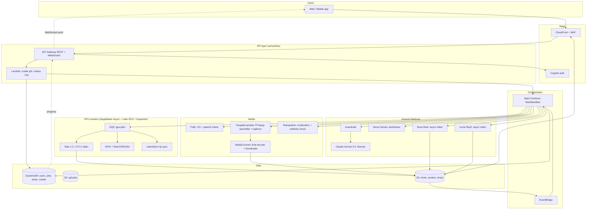

# AI Short-Form Video Generator on AWS: Implementation Plan

> Companion to `deep-research-report (1).md`. That report is cloud-agnostic and partly GCP-focused.
> This document turns it into an **all-AWS** design: models, architecture, workflow, costs, and a phased roadmap.
>
> **Prices are approximate us-east-1 list prices as of late 2026. Check them on the AWS pricing pages before committing a budget.**
> Model availability on Bedrock changes often, so check the Bedrock model catalog in your region before you build.

---

## 1. What we are building

A user types an idea, such as "30-second reel about morning coffee rituals, cozy, warm tones, voiceover". They get back a **finished vertical 9:16 reel** with:

- multiple shots, each 5–6 s, with a consistent look
- a voiceover, background music, and burned-in captions
- moderation checks, a watermark, and a link to download or share

This is the Higgsfield / Google Flow pattern: an **"AI director" LLM** plans the reel, a **router** sends each shot to the best video model, and a **post-production pipeline** assembles the final video.

---

## 2. Corrections to the research report (read first)

Several claims in the report would lead to wrong decisions on AWS:

| Report says | Reality | Impact |
|---|---|---|
| "Bedrock is image-focused, video support minimal" | Bedrock has **text/image-to-video models**: **Amazon Nova Reel** (up to 2 min multi-shot, 720p) and **Luma Ray2**. | We can launch an MVP with no GPUs at all. |
| Stable Diffusion weights are "CC BY-NC" | SD 1.5 is CreativeML OpenRAIL-M. SVD/SD3.5 use the **Stability Community License** (free commercial use under $1M revenue, enterprise license above that). | Licensing is manageable, but read each license. |
| "Kling, Seedance… Runway models" | Kling is from Kuaishou, Seedance from ByteDance, Wan from Alibaba. Runway's API resells some of them. | Choose models by vendor and license, not by reseller. |
| Compute ≈ $0.016 per 10 s clip; 1,000 clips/day ≈ $5.5k/month | Current open video models (Wan 2.2, HunyuanVideo, LTX) need **minutes of GPU time per 5 s of 720p video**, not seconds. | Realistic self-hosted cost is **10–50× higher** than the report says (see §7). |
| Use Wav2Lip and MusicGen | **Wav2Lip and MusicGen weights are non-commercial.** | Use LatentSync / MuseTalk and ACE-Step, or licensed music, instead. |
| Watermark with SynthID | SynthID is Google-only. | On AWS, use Nova's built-in watermark plus **C2PA content credentials** and a visible mark. |
| FVD for evaluation | FVD is useful for research but weak for product decisions. | Use **VBench** plus pairwise human preference plus engagement data. |

**Key AWS constraint to design around:** Nova Reel currently outputs **1280×720 landscape only**. Instagram Reels and Stories need **720×1280 / 1080×1920 vertical**. Cropping 16:9 to 9:16 discards about 70% of the frame. That is why this plan uses a **hybrid**: Bedrock for speed and zero ops, plus a self-hosted open model (Wan 2.2) that generates **native vertical** video.

---

## 3. Model selection (all on AWS)

### 3.1 The pipeline stages and the model for each

| Stage | Primary (MVP) | Alternative / Production | Runs on | License notes |
|---|---|---|---|---|
| **Director / storyboard LLM** (script, shot list, per-shot prompts, VO text, captions, music mood) | **Claude Sonnet 5.5** on Bedrock (structured JSON output) | Claude Haiku 5.5 for cheap re-writes; Amazon Nova 2 Lite | Bedrock | Commercial OK |
| **Prompt / input safety** | **Bedrock Guardrails** | + custom deny-lists | Bedrock | — |
| **Keyframe / first-frame image** (character and style consistency) | **Amazon Nova Canvas** | Stability SD3.5 Large / Stable Image Ultra on Bedrock; self-hosted FLUX/SDXL + LoRA for custom characters | Bedrock / GPU | Check Stability/FLUX licenses |
| **Video, landscape / fast path** | **Amazon Nova Reel** (T2V and I2V, 6 s shots, 24 fps, 720p, built-in watermark) | — | Bedrock (async) | Commercial OK, AWS indemnity |
| **Video, premium shots** | **Luma Ray2** (540p/720p, 5–9 s) | — | Bedrock (async) | Commercial OK |
| **Video, vertical / custom path** | **Wan 2.2** (TI2V-5B for speed, A14B T2V/I2V for quality) + LightX2V step-distillation LoRAs | **LTX-2** (fast, generates audio+video), **HunyuanVideo 1.5** | Self-hosted GPU | Wan: Apache-2.0. LTX-2: free under a revenue threshold. Hunyuan: community license that **excludes EU/UK/South Korea** |
| **Voiceover (TTS)** | **Amazon Polly** generative voices (includes **speech marks** = word timings for captions) | Nova Sonic for conversational use; Kokoro (Apache-2.0) self-hosted | Managed / GPU | Commercial OK |
| **Music** | **Licensed stock library** (lowest legal risk) | **ACE-Step** (Apache-2.0) self-hosted | S3 / GPU | Avoid MusicGen (non-commercial) |
| **Lip-sync / talking avatar** (phase 2) | **LatentSync** (Apache-2.0) or **MuseTalk** (MIT) | **Wan 2.2-S2V** (speech-to-video) | GPU | Avoid Wav2Lip (non-commercial) |
| **Frame interpolation** (16 fps → 24/30 fps) | **RIFE** (MIT) | — | GPU (small) | OK |
| **Upscale 720p → 1080p** | **Real-ESRGAN** (BSD) | **SeedVR2** (Apache-2.0), higher quality but slower | GPU | OK |
| **Captions** | Polly speech marks → ASS/SRT | Amazon Transcribe for user-uploaded audio | Managed | — |
| **Output moderation** | **Rekognition** image moderation on keyframes + sampled frames; **celebrity recognition** to block deepfakes of public figures | Rekognition Video `StartContentModeration` for full scans | Managed | — |
| **Assembly / encoding** | **FFmpeg** on Lambda/Fargate | **AWS Elemental MediaConvert** for final encode, HLS, thumbnails | Managed | — |
| **Video understanding** (phase 3: "AI Clipper" for long uploads) | **TwelveLabs Pegasus / Marengo** on Bedrock | Claude with frame sampling | Bedrock | — |

### 3.2 Router logic (which video model per shot)

```
if shot.aspect == "9:16" or shot.needs_custom_character_lora:   -> Wan 2.2 (self-hosted)
elif user.tier == "premium" and shot.is_hero:                    -> Luma Ray2
elif shot.aspect == "16:9":                                       -> Nova Reel
fallback on error/timeout/quota                                   -> next model in chain
```

All video adapters implement one interface: `submit(shot) -> job_id`, then `on_complete(job_id) -> s3://.../shot.mp4`. Adding a new model (for example a future Nova Reel version with vertical output, or a third-party API) is then a config change, not a rewrite.

---

## 4. Architecture

### 4.1 High-level diagram



### 4.2 The workflow (Step Functions `ReelWorkflow`, Standard type)

| # | State | Implementation | Notes |
|---|---|---|---|
| 1 | **ValidateAndReserveCredits** | Lambda + DynamoDB conditional write | Rejects users without credits before any spend. |
| 2 | **InputSafety** | Bedrock Guardrails `ApplyGuardrail` | Blocks disallowed prompts. Also scans user uploads with Rekognition (faces → consent check). |
| 3 | **Direct (storyboard)** | Bedrock Claude Sonnet 5.5, JSON schema output | Produces the storyboard JSON (§4.3). Optional human-in-the-loop step: "approve storyboard" using `waitForTaskToken`. |
| 4 | **Keyframes** (Map over shots) | Nova Canvas, with the same style/character seed reused across shots | Gives image-to-video consistency between shots. Rekognition moderation runs on each keyframe (cheap, catches problems before expensive video generation). |
| 5 | **GenerateShots** (Map, `MaxConcurrency` 4–6) | Router Lambda → Bedrock `StartAsyncInvoke` **or** SQS GPU job, using the `.waitForTaskToken` callback | Completion is reported via EventBridge (S3 object created) or the GPU worker calling `SendTaskSuccess`. Retries plus the fallback chain live here. |
| 6 | **Audio** (parallel branch with step 5) | Polly `SynthesizeSpeech` (audio + speech marks), music selection or ACE-Step | Shot durations are fitted to VO timing from the speech marks. |
| 7 | **PostProcessShots** (Map) | GPU worker: RIFE to 24/30 fps, Real-ESRGAN to 1080×1920, optional lip-sync | Skip for Nova Reel shots that are already 24 fps. |
| 8 | **OutputModeration** | Sample 1 frame/s → Rekognition `DetectModerationLabels` + `RecognizeCelebrities` | Fail → regenerate the shot with an adjusted prompt (max 2 attempts) → otherwise refund and flag for review. |
| 9 | **Assemble** | Fargate task (FFmpeg): concat shots, transitions, ducked music, VO, burned-in captions (ASS from speech marks), visible watermark | Lambda (10 GB, 15 min) is enough for ≤60 s reels. Fargate gives headroom. |
| 10 | **Finalize** | MediaConvert: H.264 1080×1920 MP4 + thumbnail + optional HLS. Embed **C2PA manifest** | |
| 11 | **Commit** | DynamoDB update, charge credits, WebSocket notify, CloudFront signed URL | |
| ✗ | **Catch-all** | Refund credits, mark failed, alarm | |

**Why Step Functions:** native Bedrock and SQS integrations, `waitForTaskToken` for long GPU jobs (no polling), Map state for parallel shots, built-in retries, and a visual execution history for debugging each reel. A 30 s reel uses roughly 60–100 state transitions, about $0.002–0.003 per reel.

### 4.3 Storyboard contract (Director LLM output)

```json
{
  "title": "Morning Coffee Rituals",
  "aspect": "9:16",
  "total_duration_s": 30,
  "style": { "look": "warm cinematic, shallow depth of field, 35mm", "palette": "amber, cream", "seed": 48213 },
  "characters": [{ "id": "c1", "description": "woman, late 20s, curly hair, beige knit sweater" }],
  "voiceover": { "voice": "Ruth", "text": "Every morning starts with a small ritual..." },
  "music": { "mood": "lofi, calm", "bpm": 80 },
  "shots": [
    {
      "id": "s1", "duration_s": 5, "camera": "slow push-in",
      "keyframe_prompt": "close-up of hands grinding coffee beans on a wooden counter, morning window light",
      "motion_prompt": "hands turning the grinder handle, steam rising in background",
      "characters": ["c1"], "caption": "Every morning starts with a small ritual",
      "model_hint": "auto"
    }
  ]
}
```

Use **structured outputs** (a JSON schema) so the workflow never has to parse free text. The Director's system prompt holds the per-model prompt-writing rules (Nova Reel, Wan, and Ray2 each respond best to different prompt styles).

### 4.4 GPU worker tier

**MVP: SageMaker Asynchronous Inference**
- One endpoint per model container (Wan 2.2, post-processing).
- Request payload goes to S3; the endpoint queues internally; results go to S3 with an SNS notification.
- **Scales to zero** when idle (`MinCapacity=0`), so idle GPUs cost nothing during the MVP. Trade-off: about 5–10 minutes of cold start when scaling up from zero.
- Instance: **`ml.g6e.xlarge`** (1× L40S, 48 GB). That is enough VRAM for Wan 2.2 A14B in FP8 at 720p, or the 5B model with room to spare.

**Production: EKS + Karpenter** (switch at roughly >2–3 GPUs busy all day)
- Karpenter NodePools: `g6e.xlarge`/`g6e.2xlarge` **Spot** (default), `g6e` on-demand (fallback), `p5` (H100) for a premium-latency tier.
- Workers pull from **SQS** (KEDA scales on queue depth). Spot interruption → message becomes visible again → job retries. Make shot jobs idempotent and short (one shot = one message).
- Model weights stored in S3 and loaded via **Mountpoint for S3** or a pre-baked AMI/EBS snapshot (cuts cold start from minutes to seconds). Keep a small **warm pool**.
- Inference optimizations: FP8 weights, step-distilled LoRAs (4–8 steps instead of 40–50), `torch.compile`, TeaCache / FlashAttention-3, and batching several shots of the same reel on one GPU.
- Observability: NVIDIA DCGM exporter → Amazon Managed Prometheus/Grafana.

**Alternative:** AWS Batch on EC2 GPU, which is simpler than EKS if the team has no Kubernetes experience.

### 4.5 Cross-cutting concerns

- **Region:** **us-east-1** for Bedrock video models and the best GPU capacity. Users in India are served through **CloudFront** edges (Mumbai, Chennai, etc.). If personal data must stay in India, keep Cognito/DynamoDB/user uploads in **ap-south-1** and send only prompts and asset references to us-east-1. Get legal review on this under the DPDP Act.
- **Caching / dedup:** hash `(model, version, prompt, seed, params)` → S3 key. Re-renders that change only the music or captions reuse the shots and skip all GPU work.
- **Cost controls:** credit reservation before work starts, per-user rate limits (API Gateway usage plans), a cap on shots and length per tier, AWS Budgets alarms, and **cost allocation tags per job** (`job_id`, `model`) so true cost per reel is visible.
- **Security:** KMS on all S3 buckets and DynamoDB, VPC endpoints for S3/Bedrock/SQS (avoids NAT data charges), least-privilege IAM per Lambda, signed CloudFront URLs, and WAF bot control.
- **IaC / CI-CD:** AWS CDK (TypeScript or Python). Model containers live in ECR, are built by CodeBuild/GitHub Actions, and are promoted dev → staging → prod. SageMaker Model Registry versions the self-hosted models.
- **Observability:** CloudWatch metrics per state (latency p50/p95, failures, fallback rate), X-Ray traces, and a dashboard showing $/reel by model.

---

## 5. Safety, legal, and IP checklist

1. **Input:** Bedrock Guardrails (sexual, violence, hate, self-harm, denied topics), plus a denied-terms list (real public figures, minors in sexual or violent contexts, trademarks).
2. **Faces:** if a user uploads a face, require a consent checkbox, and use a Rekognition face match against the account owner's verified selfie before allowing "use my face". Block `RecognizeCelebrities` hits on outputs.
3. **Output:** frame-sampled Rekognition moderation, with a human-review queue (Amazon A2I or an internal tool) for borderline confidence (for example 50–80%).
4. **Provenance:** Nova models embed an invisible watermark. Add **C2PA** manifests to all finals plus a visible "AI-generated" mark. This aligns with EU AI Act Art. 50 and India's emerging synthetic-media labelling rules.
5. **Licenses:** keep a `MODEL_LICENSES.md` register. Wan 2.2 (Apache-2.0) is the safest open model. HunyuanVideo's territory exclusions, the LTX revenue threshold, and the Stability revenue threshold must be tracked.
6. **Music:** use a licensed library or self-generated (ACE-Step) music only. Never let users pick commercial songs inside the app; Instagram lets them add music at posting time.
7. **Abuse:** rate limits, report button, audit log (prompt, model, seed, output hash) kept for 90+ days.

---

## 6. Phased roadmap

| Phase | Duration | Scope | Exit criteria |
|---|---|---|---|
| **0. Spike** | 1–2 weeks | Notebook: Claude storyboard → Nova Reel shots → Polly VO → FFmpeg. Separately benchmark **Wan 2.2 TI2V-5B and A14B (+ distillation LoRA) on g6e.xlarge** for 720×1280×5 s: time, VRAM, quality. | Real numbers for §7, and a go/no-go on the vertical-generation model. |
| **1. MVP** | 6–8 weeks | Everything in §4 using **SageMaker Async** for GPUs. Single style, 15–30 s reels, VO + music + captions, moderation, credits. | 50 beta users, p95 end-to-end < 8 min, < 5% failed jobs, cost/reel measured. |
| **2. Quality and features** | 6–8 weeks | Storyboard editor (regenerate one shot), character consistency (LoRA from 10–20 user photos, trained on a SageMaker training job), lip-sync avatar, premium tier with Ray2, image-to-video from the user's product photos. | Human preference wins vs MVP ≥ 60%. |
| **3. Scale** | ongoing | Move GPUs to **EKS + Karpenter + Spot**, warm pools, multi-shot batching, A/B router, "AI Clipper" (long video → highlights via TwelveLabs/Claude + PySceneDetect), templates. | GPU utilization > 60%, cost/reel down 40%+ from MVP. |

Team for MVP: 1 backend/infra engineer (CDK, Step Functions), 1 ML engineer (model containers, optimization), 1 frontend engineer, plus part-time design/QA.

---

## 7. Cost model

### 7.1 Unit prices used (approximate, us-east-1)

| Item | Price |
|---|---|
| Nova Reel | **~$0.08 per second** of output video (720p) |
| Luma Ray2 (Bedrock) | **~$0.75/s (540p), ~$1.50/s (720p)** |
| Nova Canvas | ~$0.04–0.08 per image (by resolution/quality) |
| Claude Sonnet 5.5 / Haiku 5.5 on Bedrock | per-token, see the Bedrock pricing page; a storyboard is about 3–6k tokens in and 1–2k out → **≈ $0.01–0.05 per reel** |
| Polly generative voices | ~$30 per 1M characters (30 s VO ≈ 450 chars ≈ $0.014) |
| Rekognition image moderation | ~$0.001 per image |
| `g6e.xlarge` (1× L40S 48 GB) | ~$1.86/h on-demand; Spot typically ~$0.6–1.0/h |
| `ml.g6e.xlarge` (SageMaker) | roughly 15–30% higher than EC2 |
| `g5.xlarge` (A10G 24 GB) | ~$1.01/h (fine for RIFE/ESRGAN, too small for Wan A14B at 720p) |
| `p5.48xlarge` (8× H100) | ~$55/h after the 2025 price cuts (~$7/GPU-h) |
| Step Functions Standard | $0.025 per 1k state transitions |
| S3 Standard | $0.023/GB-month |
| CloudFront egress | ~$0.085/GB (US/EU), ~$0.109/GB (India) for the first 10 TB |

### 7.2 Cost per 30-second reel (6 shots × 5 s)

**Path A: all Bedrock (Nova Reel)**

| Component | Cost |
|---|---|
| Director LLM (+1 retry) | $0.03 |
| 6 keyframes (Nova Canvas) | $0.30 |
| 30 s Nova Reel | $2.40 |
| Polly VO | $0.02 |
| Moderation (6 keyframes + 30 frames) | $0.04 |
| Assembly (Fargate) + MediaConvert + Step Functions | $0.03 |
| Regeneration overhead (~15% of shots) | $0.36 |
| **Total** | **≈ $3.20 / reel** (landscape only) |

**Path B: self-hosted Wan 2.2 on L40S (native vertical)**
Planning assumption, to be replaced by Phase 0 benchmarks: about **3–5 GPU-minutes per 5 s 720p shot** with distillation + FP8, and about 0.5 GPU-min per shot for RIFE + upscale.

| Component | On-demand | Spot |
|---|---|---|
| 6 shots × ~4.5 GPU-min ≈ 27 GPU-min | $0.84 | $0.36 |
| Post-processing ≈ 3 GPU-min | $0.09 | $0.04 |
| LLM + keyframes + VO + moderation + assembly | $0.42 | $0.42 |
| Regeneration overhead (~15%) | $0.14 | $0.06 |
| **Total (at ~70% GPU utilization)** | **≈ $1.90** | **≈ $1.10** |

Unoptimized Wan 2.2 A14B (50 steps, no distillation) can take 15–30+ GPU-minutes per shot. That alone would make Path B **more expensive than Nova Reel**, so the optimization work in Phase 1 is required.

**Path C: premium (Ray2 720p for hero shots)**
2 hero shots × 5 s × $1.50 = $15, plus the rest on Path A or B ≈ **$17–18 / reel**. Only viable as a paid premium tier.

### 7.3 Monthly scenarios

| | **Prototype / beta** | **MVP launch** | **Growth** |
|---|---|---|---|
| Reels / month | 300 | 3,000 (100/day) | 30,000 (1,000/day) |
| Mix | 100% Bedrock + Wan via SageMaker Async (scale-to-zero) | 50% Bedrock, 50% Wan | 15% Bedrock, 85% Wan on EKS Spot |
| Generation (variable) | ~$800 | ~$7,500 | ~$40,000 |
| GPU baseline / warm pool | $0 (scale to zero) | ~$500 | ~$2,500 (2–3 warm GPUs) |
| Platform (API GW, Lambda, DynamoDB, Step Functions, Cognito, CloudWatch, NAT/VPC endpoints, EKS control plane) | ~$100 | ~$400 | ~$1,500 |
| S3 storage (30 s 1080p ≈ 20–25 MB; keep shots 30 days, finals 1 year) | ~$5 | ~$50 | ~$400 |
| Egress (≈ 3 downloads/views per reel in-app; most viewing happens on Instagram) | ~$5 | ~$30 | ~$250 |
| **Total / month** | **≈ $0.9k** | **≈ $8.5k** | **≈ $45k** |
| **Cost per reel** | ~$3.00 | ~$2.80 | ~$1.50 |

**Pricing implication:** for healthy margins, charge **≥ $0.50–1.00 per finished 30 s reel at scale**, for example a credit pack where 1 reel = 10 credits and $15/month buys 15–25 reels. Give free tiers short (≤10 s), watermarked, 720p reels.

**Biggest cost levers** (in order):
1. GPU-minutes per shot (distillation, FP8, compile): 3–10×
2. Spot vs on-demand: ~2×
3. GPU utilization (batching, warm pool sizing): ~1.5×
4. Regeneration rate (better Director prompts, keyframe preview before video generation): ~1.2×
5. Reusing shots when users edit only audio or captions
6. Nova Reel for 16:9 output, which needs no GPU management

Savings Plans / Reserved capacity become worthwhile once baseline GPU usage is steady (phase 3).

---

## 8. Code sketches

### 8.1 Nova Reel async shot (Lambda, Python / boto3)

```python
import boto3, json
br = boto3.client("bedrock-runtime", region_name="us-east-1")

def submit_nova_reel(shot, keyframe_b64, out_prefix):
    resp = br.start_async_invoke(
        modelId="amazon.nova-reel-v1:1",
        modelInput={
            "taskType": "TEXT_VIDEO",
            "textToVideoParams": {
                "text": shot["motion_prompt"],
                "images": [{"format": "png", "source": {"bytes": keyframe_b64}}],  # image-to-video
            },
            "videoGenerationConfig": {
                "durationSeconds": 6, "fps": 24, "dimension": "1280x720", "seed": shot["seed"],
            },
        },
        outputDataConfig={"s3OutputDataConfig": {"s3Uri": out_prefix}},
    )
    return resp["invocationArn"]   # completion -> S3 object -> EventBridge -> SendTaskSuccess
```

### 8.2 GPU worker loop (container on SageMaker Async or EKS)

```python
# pseudo-code
while True:
    msg = sqs.receive_message(QueueUrl=Q, WaitTimeSeconds=20, VisibilityTimeout=900)
    for m in msg.get("Messages", []):
        job = json.loads(m["Body"])
        if s3_exists(job["output_key"]):            # idempotent: retry after Spot interruption
            sfn.send_task_success(taskToken=job["token"], output=json.dumps({"key": job["output_key"]}))
        else:
            video = wan_pipeline(prompt=job["motion_prompt"], image=load(job["keyframe_key"]),
                                 height=1280, width=720, num_frames=81, steps=6, seed=job["seed"])
            upload(video, job["output_key"])
            sfn.send_task_success(taskToken=job["token"], output=json.dumps({"key": job["output_key"]}))
        sqs.delete_message(QueueUrl=Q, ReceiptHandle=m["ReceiptHandle"])
```

### 8.3 Assembly (FFmpeg, simplified)

```bash
ffmpeg -f concat -safe 0 -i shots.txt -i vo.mp3 -i music.mp3 \
  -filter_complex "[2:a]volume=0.18[m];[1:a][m]amix=inputs=2:duration=first[a];[0:v]ass=captions.ass,overlay=W-w-24:24[v]" \
  -map "[v]" -map "[a]" -c:v libx264 -preset medium -crf 20 -pix_fmt yuv420p -c:a aac -b:a 160k \
  -movflags +faststart final_1080x1920.mp4
```

---

## 9. Evaluation

- **Offline:** **VBench** dimensions (subject consistency, motion smoothness, aesthetic quality, text alignment) on a fixed set of 200 internal prompts, run per model version.
- **Human:** weekly blind pairwise comparisons (A vs B) on 50 prompts. Target ≥ 60% win rate before promoting a router change.
- **Product:** completion rate, regenerate rate per shot, download/share rate, p95 latency, $/reel.
- **Guardrail metrics:** moderation block rate and false-positive rate (sampled human audit).

---

## 10. Open decisions

1. **Vertical-first?** If 9:16 is mandatory from day one, Wan 2.2 self-hosting is on the MVP critical path, so run the Phase 0 benchmark first.
2. **Data residency:** must user data stay in India (ap-south-1)?
3. **Avatars / talking heads in MVP?** These add lip-sync and face-consent flows, about +3 weeks.
4. **Music source:** licensed library vendor vs generated (ACE-Step).
5. **Pricing / credit model:** confirm the target margin against the §7 numbers.
