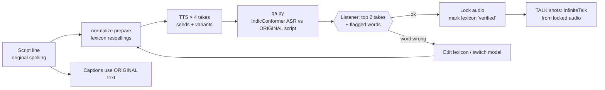

# Hindi Pronunciation: How We Control It

> Response to `deep-research-report_2.md` (Hindi TTS mispronunciation). This covers what in that report holds up, what doesn't fit our stack, and the concrete mechanism now in the repo:
> - `pipeline/vrea/pronounce/lexicon.tsv`: respelling lexicon
> - `pipeline/vrea/pronounce/normalize.py`: text preparation + risk flags
> - `pipeline/vrea/pronounce/qa.py`: multi-take ASR scoring
> - `pipeline/tests/test_pronounce.py`: 11 tests, passing

---

## 1. Why Higgsfield / Flow can't fix this, and why we can

Higgsfield and Google Flow generate speech **inside the video model** (Veo 3, Kling, etc.). When a word comes out wrong, the only fix is to re-roll the whole clip: dollars per attempt, and the new take may break a different word.

Our pipeline is **audio-first**:
- the voice track is generated alone and checked
- only then are the talking-head shots generated *from* that audio

So a pronunciation fix costs **one TTS re-run (about a second of GPU time)**, not a video re-render. **The pronunciation gate must pass before any TALK shot is rendered.** That is the main design rule here.

---

## 2. Review of the research report

**What holds up**
- The error taxonomy is right: schwa deletion, consonant clusters, retroflex vs dental, vowel length, nasalization, loanwords and names.
- The general approach is sound: lexicon of exceptions, then automatic checking, then human listening.
- The ASR / forced-alignment "produce-then-correct" loop is the right idea, and it's what `qa.py` implements.

**What doesn't fit our stack**
- **Phoneme/IPA input doesn't apply.** Our TTS models (IndicF5, Indic Parler-TTS, and the newer Indic-Speak) read **Devanagari text only**; none accepts phonemes. The report's main fix (G2P → feed IPA to the TTS) only works with older Tacotron/FastSpeech-style models or SSML phoneme tags. With our models, the equivalent lever is **respelling the text** the model reads (§3).
- **Its tool comparison is outdated.** Mozilla TTS is unmaintained. Coqui the company shut down in 2024, and its XTTS weights are non-commercial. It ignores the models built for Indian languages that we actually use (AI4Bharat's IndicF5 and Indic Parler-TTS, trained on 1,400–1,800 hours of Indic speech).
- **Fine-tuning advice is premature.** "Train FastSpeech2 on 25 h" is a project of months. With current models the cheaper steps (§4, levels 0–3) should come first.

**What's wrong**
- **The sample G2P code is broken.** I ran it:

  | Input | Output | Correct (approx.) |
  |---|---|---|
  | दादी | `d̪əaːd̪əiː` | `d̪aːd̪iː` |
  | भारत | `bʱəaːrət̪` | `bʱaːrət̪` |
  | जब तब | `dʒəbə t̪əb` | `dʒəb t̪əb` |
  | पृथ्वी | `pət̪ʰʋəiː` | `prɪt̪ʰʋiː` |

  The bugs:
  - vowel signs are appended *after* the inherent schwa instead of replacing it
  - schwa is dropped only at the end of the whole text, not per word
  - ृ is missing entirely
  - medial schwa deletion (कमला → kamlā) isn't handled

  Don't build on it.
- **Several examples are incorrect:**
  - "टालना vs तालना (avoid)" is not a real minimal pair.
  - विषय has no ष+य cluster (vi-ṣa-ya).
  - "महात्मा गांधी contains a Sandhi" is wrong.
  - The विकास example is garbled.
- **Two vendor facts need correcting:**
  - Polly's Hindi voices are Aditi (standard) and **Kajal (neural)**. Raveena is an Indian-English voice.
  - Bedrock has no TTS, correctly noted, but Polly also has no child or elderly Hindi voice, which matters for Tara and Dadi.

---

## 3. Respelling: steering a text-only TTS

The model pronounces what it reads, so we write the word the way it is *spoken*. Respellings apply **only to the TTS input**; captions keep the correct spelling.

| Problem | Rule | Example (script → TTS input) |
|---|---|---|
| Final or medial schwa spoken when it should be silent | add halant ् | ओम → **ओम्**, धड़कन → **धड़्कन** (variant) |
| ष read as a distinct retroflex sibilant | ष → श (Hindi speech merges them) | सूक्ष्म → **सूक्श्म**, विष्णु → **विश्णु** |
| ऋ / ृ | spell as रि | सृष्टि → **स्रिश्टि**, पृथ्वी → **प्रिथ्वी** |
| ज्ञ | spell as ग्य | विज्ञान → **विग्यान** |
| Anusvara before a stop | write the matching nasal consonant | ब्रह्मांड → **ब्रह्मान्ड** |
| Isolated letters (A-U-M) | halant + pause marks | "अ, उ, और म" → **"अ... उ... और म्"** (otherwise the model says "ma") |
| Symbols, digits, abbreviations | write out as words | ॐ → **ओम्** |
| English words | Devanagari transliteration | Big Bang → **बिग बैंग** |
| Nukta / visarga stumbles | drop if it causes glitches | ख़ामोशी → खामोशी (variant), दुःख → दुख |
| Dashes, quotes, colons | convert to pauses or remove | "— 'बिग बैंग' —" → ", बिग बैंग," |

**Every respelling is a hypothesis until someone listens to it.** The lexicon has a `status` column: `proposed`, then `verified` or `rejected` after a native listener checks the audio. Words with several plausible fixes list them as alternatives (`ब्रह्मान्ड | ब्रम्हान्ड`), and the pipeline can try each one.

**Style decision (made 2026-11-03): Sanskritized.** Deity and scripture words use the Sanskritized pronunciation (ब्रह्मा as "brah-mā", not everyday "bram-hā"). The colloquial respellings were removed as alternatives, and the decision is recorded at the top of the lexicon.

`normalize.py` on the Srishti ep1 script currently fixes 9 words and flags 7 words for a listener to check (पवित्र, ध्वनि, प्रकट, तत्वों, आवाज़ and similar):

```bash
cd pipeline && python3 -m vrea.pronounce.normalize ../stories/srishti-ep1/storyboard.json
```

---

## 4. The fix ladder (cheapest first)

| Level | What | Cost | Catches |
|---|---|---|---|
| **0. Normalize + lexicon** | `normalize.prepare()` before every TTS call | free | known-hard words, symbols, loanwords, punctuation glitches |
| **1. Multiple takes + automatic ranking** | 4 takes per line (different seeds and lexicon variants) → Hindi ASR (IndicConformer, MIT) → `qa.py` ranks by word mismatches, pace and character error rate | ~1–2 GPU-seconds per take; under $0.05 per episode | skipped, garbled, repeated or wrong words; stalls; mangled loanwords |
| **2. Native listener on the top 2 takes** | Listen only to flagged words plus the top take of each line; mark lexicon entries verified or rejected | ~10 min per episode | subtle schwa, vowel length, retroflex and stress errors that ASR misses |
| **3. Lexicon fix + re-run** | Add or adjust the respelling, regenerate only that line | seconds | recurring words; the lexicon grows into a reusable asset across episodes |
| **4. Switch model for that line** | IndicF5 ↔ Indic Parler-TTS ↔ Indic-Speak (license check pending) | seconds | words one model consistently fails |
| **5. Human-guided line** | Voice actor records the line, used directly or as the IndicF5 reference for that line | minutes | the last few stubborn words or names |
| **6. Fine-tune (later)** | When the verified lexicon and corrected lines reach ~30–60 min, fine-tune the TTS on them | ~$5–20 GPU | domain vocabulary (Sanskrit / devotional), permanently |

Avoid splicing a single re-synthesized word into a sentence. The pitch and timing seams are audible, and lip-sync then follows the seam. Re-generate the whole sentence instead.

**What ASR can't do:** its language model often "hears" the correct word even when the schwa or vowel length is slightly off. That's why level 2 (a person listening) stays in the loop. It's a short review of pre-filtered takes, not a full listen-through.

---

## 5. Where it sits in the pipeline



Two details matter:
- **The ASR compares against the original script**, not the respelled text, because ASR writes standard spelling. `qa.canon()` ignores differences you can't hear (nukta, chandrabindu vs anusvara, final halant, ष/श).
- **The IndicF5 reference recording must have an exact transcript.** A mismatched `ref_text` is a common cause of garbled first words. Record clean, 10–15 s Hindi reference clips and transcribe them exactly.

---

## 6. Next steps

1. **TTS bake-off on the 7 ep1 lines** (Week 1, same GPU session): IndicF5 vs Indic Parler-TTS vs **Indic-Speak**.
   - AI4Bharat's model cards now recommend Indic-Speak (3.3B, Llama-3.2-based, 22 languages, code-mixing support).
   - Its license is "other" and the repo is gated, so read its terms before any commercial use.
   - Run 4 takes per line through `qa.py` and have a native listener do a blind A/B.
2. ~~Lock the Sanskritized vs colloquial style decision.~~ Done: Sanskritized.
3. Have a native listener mark the lexicon entries verified or rejected. Carry the lexicon into every future episode.
4. Add `qa.py` to the quick-test session; it needs `HF_TOKEN` with access to `ai4bharat/indic-conformer-600m-multilingual`, a gated MIT-licensed model.

---

## 7. First run (2026-11-03, Indic Parler-TTS, Sanskritized lexicon)

Setup: 7 lines × 4 takes on a g6e.2xlarge. Generation took about 6–27 s per take, and ASR ranking under 2 minutes in total. IndicConformer ranked the takes (`infra/quicktest/smoke/`).

Voices: Indic Parler-TTS has no child or elderly voices, so Tara used Divya (described as "high-pitched, bright") and Dadi used Rani (described as "slow, warm, low-pitched").

**The ranking works.** Every line has at least one take with 0–1 word issues. The rejected takes have real errors: a garbled phrase ("हवा फिर आग" heard as "आ गया फिर आख फिर आख"), a clipped ध्वनि, जागी heard as "जाकी", बोलती heard as "भूलती", and धड़कन heard as "धड़कनपन".

**Two fixes were needed in `qa.py`:**
- **ASR spelling noise.** `canon()` now ignores doubled nasal marks (अन्ंदर, चाँंद), doubled halant, तत्त्व/तत्व, and जी written apart or joined.
- **Pace band.** It was recalibrated to 6.5–18 characters/s, because Parler speaks at about 8 characters/s.

**Pronunciation findings, now added to the lexicon as variants:**

| Word | What happened | Next try |
|---|---|---|
| ओम्, Tara's voice | heard as "um" in 4/4 takes (Dadi's voice was fine) | ओऽम्, ओ म् |
| उ in "अ, उ, और म" | stretched to "ऊ" in 4/4 takes | drop the ellipsis: "उ," |
| म् (letter M) | heard as "माँ" in 2/4 takes | म्म् |
| ध्वनि | onset clipped in 2/4 takes | ध्वनी |

**Still needed:** a native listener on the top take of each line. ASR can't hear schwa or vowel-length detail, and it doesn't judge whether the Sanskritized ब्रह्मा sounds right.

---

## 8. Voice consistency and emotion (plan, 2026-11-03)

Feedback on the first run: the voices sound **robotic**, and the voice **changes between lines**.

**Why it happens.** Indic Parler-TTS builds a voice from a *text description* on every call. Each take samples a slightly different speaker, so nothing ties line 3's Dadi to line 1's Dadi. Its emotion control is officially tested only for 10 languages, and Hindi is not one of them. So the delivery comes out flat.

**The fix: one fixed reference voice per character, cloned for every line.** IndicF5 (MIT) clones a voice from a 10–15 s reference clip plus its exact transcript. It copies both the timbre and the delivery (pace, pitch movement, warmth) of that clip.
- **Consistency:** the same reference is used for every line, so it's the same voice every time.
- **Emotion:** it comes from the reference. A lively reference gives lively lines. Each character can get a few references from the same speaker (for example Tara curious, Tara excited, Dadi warm narration), chosen by the line's `emotion` field.

**Where the reference comes from:**

| Stage | Source | Status |
|---|---|---|
| Now (stopgap) | Generate 8 expressive Indic Parler candidates per character. Keep the clean ones (ASR: 0 word issues), then pick the most expressive (largest pitch spread). | `infra/quicktest/smoke/voice_v2` |
| Next (recommended) | **Human voice actors**, with written permission: a young girl's voice for Tara, an older woman's for Dadi. Record 2–3 clips of 10–15 s each, in different emotions, quiet room, phone is fine, exact transcript. | needs recordings |
| Later | Fine-tune on about 30–60 min of each actor's speech for a fully stable, owned voice. Also evaluate Indic-Speak (AI4Bharat's recommended successor; gated, license to check). | later |

**Measuring it, not just listening.** `voice_score.py` adds two numbers to the ASR check for every take:
- **Speaker similarity:** WavLM x-vector cosine against the character's reference. This measures consistency.
- **Pitch spread:** F0 standard deviation in semitones. A low value means monotone, a rough "robotic" measure.

Takes are ranked by word issues first, then by similarity. Baseline Parler takes are scored the same way, so the improvement is measured.
