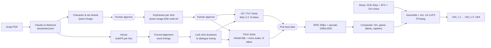

# MVP Plan: Vertical AI Story Reels on AWS (lowest cost, good quality)

> Supersedes the MVP sections of `aws-implementation-plan.md` now that these decisions are made:
>
> | Decision | Choice |
> |---|---|
> | Format | **9:16 vertical only** (1080×1920 final) |
> | Region | **Whichever is cheapest**: US regions for GPU Spot (see §5.3) |
> | Avatars | **Yes**: talking-head shots with lip-sync, consistent faces |
> | Music | Anything for MVP (generated or royalty-free) |
> | Cost priority | **Minimum cost** |
> | Trial content | *Srishti* series, Clips 1.1–1.5 (Tara & Dadi, Om → Tridev → Pancha Tattva) |
>
> All prices are approximate list prices as of late 2026. GPU timings are **planning estimates to be replaced by the Week-1 benchmark**.

---

## 1. Strategy in one paragraph

Since output must be vertical, **Amazon Nova Reel is out** (it only outputs 1280×720 landscape). Paid per-second video APIs (Luma Ray2 at ~$0.75–1.50/s) are 10–50× too expensive for a minimum-cost goal. So the MVP runs **open-weight, commercially licensed models (Apache-2.0 / MIT) on one rented AWS Spot GPU**, and uses Bedrock only for the cheap LLM "director" step. Quality comes from three things:
- **audio-first production**: voices are generated first, and their timing drives the shots and the lip-sync
- **reference-locked characters**: approved character sheets feed every keyframe
- **multiple takes per shot with a human pick**

Exact things (the ॐ glyph, captions, glows) are **composited**, never generated.

---

## 2. The trial story: breakdown and technique per shot

5 reels × 20–25 s ≈ **2 minutes of finished video**. Each clip is published as its own reel; a combined cut is a bonus.
Script version: the **"Suggested"** lines throughout. Tara's optional third line in Clip 1.5 is **dropped**, as the script note recommends; the chest-glow visual carries that beat.

Shot techniques (legend):
- **TALK**: audio-driven talking-head generation (InfiniteTalk), lip-synced to the voice track
- **I2V**: image-to-video from an approved keyframe (Wan 2.2)
- **FLF**: first-and-last-frame video (Wan, morphs keyframe A → keyframe B)
- **COMP**: deterministic compositing/procedural effect (Python/FFmpeg; no AI)

| Clip | Shot | Time | Content | Tech |
|---|---|---|---|---|
| **1.1** Before Creation (25 s) | A | 0–3 | Wide: cozy living room at dusk; Dadi and Tara on sofa, Tara holding a black sheet of paper | I2V |
| | B | 3–8 | MCU Tara (puzzled, wide-eyed): *"Daadi, jab sooraj, chaand…"* | TALK |
| | C | 8–15 | MCU Dadi (calm storyteller): *"Tab na koi roop tha… 'Om'."* | TALK |
| | D | 15–19 | Slow push-in on the black paper until it fills the frame (Dadi VO continues) | I2V |
| | E | 19–25 | Still dark void; barely visible heat-haze ripple, looping | COMP |
| **1.2** First Light (20 s) | A | 0–4 | Ripple sharpens and begins to glow | COMP |
| | B | 4–12 | ॐ resolves from the ripple and pulses like a heartbeat, brighter with each pulse (synced to audio) | COMP |
| | C | 12–16 | Final pulse bursts into a point of golden light tearing outward | I2V (720p) |
| | D | 16–20 | Waves of golden light and energy fill the void | I2V (720p) |
| **1.3** Tridev (25 s) | A | 0–4 | ॐ hangs in golden light | COMP over I2V bg |
| | B | 4–10 | ॐ unfurls into three glowing sections at once, "like a flower opening into three petals" | FLF |
| | C | 10–16 | The three sections crystallize into Brahma, Vishnu, Shiva (vertical triangle composition) | FLF |
| | D/E/F | 16–25 | 3 × 3 s push-ins: Brahma ("A"), Vishnu ("U"), Shiva ("M"); letters glow beside each (overlay) | I2V + COMP |
| **1.4** Pancha Tattva (25 s) | A | 0–4 | Brahma extends his palm | I2V |
| | B–F | 4–25 | Continuous morph from the palm: Aakash → Vayu → Agni → Jal → Prithvi (6 keyframes, 5 chained transitions, Hindi labels overlaid) | FLF chain |
| **1.5** Spark Inside Us (25 s) | A | 0–3 | Golden light dissolves back into the living room | COMP + I2V |
| | B | 3–8 | MCU Tara (excited): *"Daadi, matlab jab main school mein 'Om' bolti hoon…"*, hand to chest | TALK |
| | C | 8–11 | CU hand on chest; faint warm pulse of light, same rhythm as 1.2-B | I2V + COMP |
| | D | 11–17 | MCU Dadi (warm smile): *"Bilkul, beta…"* | TALK |
| | E | 17–25 | Two-shot: Dadi pats Tara's head, glow fades, Tara's proud smile; end card | I2V |

Totals: **18 I2V/FLF shots (~80 s)**, **4 TALK shots (~24 s)**, **~5 COMP segments (~20 s)**, and about 30 keyframes.
The machine-readable version is in `stories/srishti-ep1/storyboard.json`.

### Why this split works
- **Talking heads only in medium close-ups, one speaker per shot.** This is the most reliable lip-sync setup. The two-shot (1.5-E) has no speech.
- **ॐ and A/U/M are composited from a real font** (Noto Sans Devanagari, OFL license). Video models garble symbols and text. Compositing also lets the pulses lock exactly to the audio heartbeat.
- **The void is procedural.** A "still dark void with a barely perceptible ripple" is easy to code and hard for diffusion models (they add noise and flicker). It also loops perfectly.
- **Morph sequences use first/last-frame video.** Each element's keyframe is approved as a still first, so the morph lands exactly on approved art.

---

## 3. Look and characters ("style bible")

- **Style:** stylized 3D animated family-film look, warm soft lighting, Indian home interiors. This style is forgiving for lip-sync, consistent across shots, suits a kids audience, and is respectful for deity depiction.
- **Palette:** room = warm amber/teak; cosmos = deep indigo-black → gold.
- **Character sheets** (generated once, human-approved, then reused as references for every shot):
  - **Tara**: ~8-year-old girl, two braids, big expressive eyes, yellow kurta.
  - **Dadi**: ~70, silver hair in a bun, round glasses, cream cotton saree with maroon border, warm smile.
  - **Living room**: sofa, diya, window at dusk, framed family photos (one background plate reused across all room shots).
  - **Brahma**: four faces, four arms, Vedas, lotus, kamandalu, golden-saffron tones, hamsa nearby.
  - **Vishnu**: blue complexion, four arms with shankha, chakra, gada, padma; yellow pitambara; crown.
  - **Shiva**: ash-blue, meditative pose, crescent moon and Ganga in jata, trishul, serpent.
- **Iconography review:** a person familiar with the iconography approves the deity sheets **before** any video is generated. Deity faces are never morphed mid-shot (morphs happen only to light and silhouettes).

---

## 4. Model stack (one GPU, all commercially licensed)

| Job | Model | License | Notes |
|---|---|---|---|
| Storyboard / prompt writing | **Claude Sonnet 5.5 on Amazon Bedrock** | Commercial | Turns the script into storyboard JSON and per-model prompts. Cents per episode. |
| Keyframes and character sheets | **Qwen-Image** + **Qwen-Image-Edit-2509/2511** (multi-reference edit) + Lightning LoRA (8 steps) | Apache-2.0 | "Put *Dadi* (ref 1) and *Tara* (ref 2) on the *sofa* (ref 3), Tara holding black paper." This is the core of face consistency. |
| Shot video (I2V, FLF) | **Wan 2.2 I2V-A14B**, FP8, with **LightX2V 4-step distill LoRA** | Apache-2.0 | 480×832 or 720×1280, 81 frames (5 s @16 fps). First/last-frame via the ComfyUI Wan FLF node. |
| Talking heads (lip-sync) | **InfiniteTalk** (audio-driven: image + voice → lips, head, and body motion) | Apache-2.0 | Primary. Bake-off alternative: **Wan 2.2-S2V-14B** (Apache-2.0). Optional polish pass: **LatentSync** (Apache-2.0). |
| Voices (Hindi/Hinglish) | **IndicF5** (zero-shot voice cloning from a 10–15 s reference) | MIT | Gives Tara a child voice and Dadi an elderly voice, which no Polly Hindi voice covers. Bake-off alternative: **Indic Parler-TTS** (Apache-2.0, voice by text description). |
| Word timings for captions | Forced alignment on the known script (ctc-forced-aligner / WhisperX) | BSD/MIT | Free, on the same box. Amazon Transcribe hi-IN (~$0.024/min) is the fallback. |
| Music bed | **ACE-Step** | Apache-2.0 | "Soft devotional ambient, tanpura drone, flute, 70 bpm." Royalty-free library tracks are fine too. |
| SFX / Om hum | CC0 SFX + **one real recorded Om chant** | — | A real chant is more authentic than synthesized. |
| Frame interpolation | **RIFE** | MIT | 16 fps → 32 fps, then encode at 30 fps. |
| Upscale to 1080×1920 | **SeedVR2-3B** (Quality) / **Real-ESRGAN** (Lean) | Apache-2.0 / BSD | |
| Compositing / assembly | Python (OpenCV + Pillow) + **FFmpeg** | — | ॐ glow and pulses, A/U/M and tattva labels, chest glow, captions (ASS), loudness −14 LUFS. |
| Runtime | **ComfyUI** (workflows driven by API) + a Python pipeline CLI | GPL-3.0 (used as a service, fine) | One saved workflow JSON per technique. |

Re-check each model card's license at download time and record it in `MODEL_LICENSES.md`.

**Voice note:** IndicF5 cloning needs consented reference recordings. Record a voice actor for Dadi, and a child voice actor with guardian consent (or an adult doing a convincing child voice), about 15 s each. That one-time recording makes every future episode consistent. **Fallback:** if TTS quality is not good enough in the bake-off, record the ~2 minutes of dialogue with the actors directly (one short session). Lip-sync and the rest of the pipeline work the same with real audio.

---

## 5. AWS setup

### 5.1 Stage 1: trial production rig (Weeks 1–4)

Minimum moving parts and minimum idle cost:

```
                 ┌─────────────── your laptop ───────────────┐
                 │ SSM port-forward → ComfyUI :8188, Review :7860 │
                 └──────────────────────┬────────────────────┘
                                        │ (no public ports)
┌───────────────────────────────────────▼──────────────────────────────────┐
│ EC2 g6e.2xlarge SPOT (1× L40S 48 GB, 8 vCPU, 64 GB RAM)                  │
│  Base DLAMI · models copied S3 → free local NVMe at boot (~3–8 min)      │
│  ComfyUI + vrea pipeline CLI + Gradio "pick-a-take" review app           │
│  watchdog: work → S3 every 3 min; idle 20 min / max hours → terminate   │
└───────┬──────────────────────────────┬───────────────────────────────────┘
        │                              │
  ┌─────▼──────┐               ┌───────▼───────────┐
  │ S3 bucket  │               │ Bedrock (Claude)  │
  │ models/env │               │ storyboard JSON   │
  │ work/      │               │                   │
  └────────────┘               └───────────────────┘
  AWS Budgets alert at $50 / $100 · CloudWatch alarm on instance hours
```

- **Instance:** `g6e.2xlarge` rather than `g6e.xlarge`. Same GPU, but 64 GB of system RAM, which loading Wan 14B (FP8) plus Qwen-Image needs. It costs only ~$0.38/h more on-demand.
- **Spot, terminate on interruption.** Nothing lives only on the instance: work syncs to S3 every 3 minutes, and each shot is an independent, cached job, so an interruption costs at most one take.
- **No NAT gateway** (saves ~$33/month). Use a public subnet with no inbound rules, and SSM Session Manager for access.
- **Model weights live in S3** (114 GB for the quick-test set ≈ $2.60/month). A cheap CPU instance downloads them from Hugging Face once; every GPU boot copies them S3 → local NVMe for free in the same region. The ComfyUI Python environment is cached in S3 too. No persistent EBS volume (this saves ~$24/month vs a 300 GB disk). Ready-to-run scripts: [`infra/quicktest/`](../infra/quicktest/README.md).

### 5.2 Stage 2: MVP service (after the trial proves quality)

The same container and workflows, wrapped for self-serve use, still scaling to zero:

- **API Gateway + Lambda + DynamoDB** (jobs, shots, credits), and a **Cognito**-protected web app on **S3 + CloudFront** (storyboard editor + pick-a-take UI).
- **Step Functions** orchestrates the job (storyboard → voices → keyframes → shots → post → assemble). Each GPU step is an **SQS** message with a task token.
- GPU workers: an **EC2 Auto Scaling Group** of Spot `g6e.xlarge/2xlarge` (mixed types, multiple AZs), **min 0**, scaled on SQS queue depth. Workers use the same S3 → NVMe pattern as Stage 1 (~5–10 min boot), so there are no disks to pay for while idle. Optional: a small warm pool for faster starts.
- This is cheaper than SageMaker Async Inference, which carries a 15–30% instance premium and has no Spot for inference. That is the main change from the earlier plan.
- Idle cost is roughly **$5–20/month** (S3 models + work, CloudWatch, tiny Lambda/DynamoDB usage).

### 5.3 Region choice (cheapest)

- On-demand GPU prices are the same in **us-east-1, us-east-2 and us-west-2**. Mumbai (ap-south-1) and other Asia regions are typically **10–25% more expensive** and have scarcer `g6e` capacity.
- Spot prices vary by AZ and change daily. Pick the region at launch with:

  ```bash
  aws ec2 get-spot-placement-scores --instance-types g6e.2xlarge g6e.xlarge --target-capacity 1 --region-names us-east-1 us-east-2 us-west-2 --single-availability-zone
  ```

  ```bash
  aws ec2 describe-spot-price-history --instance-types g6e.2xlarge --product-descriptions "Linux/UNIX" --start-time "$(date -u +%Y-%m-%dT%H:%M:%S)" --region us-east-2
  ```
- Rendering is batch work, so latency to India doesn't matter. Finished reels are small, and CloudFront serves them from Indian edge locations in Stage 2.
- Keep Bedrock (Claude) in the same region as the GPU. Default to **us-east-2 or us-west-2**, and move if Spot capacity is poor.

---

## 6. Production pipeline (audio-first)



Rules that drive quality:
1. **Voice first.** Dialogue timing sets shot length, and TALK shots are generated *from* the final audio, so lips match by construction.
2. **Approve stills before motion.** Rejecting a keyframe costs about 15 s of GPU time; rejecting a video take costs minutes.
3. **Same seed and references per character.** Every keyframe of Tara uses the Tara sheet as reference 1.
4. **Generate small, finish big.** Pick takes at preview resolution, and upscale only the chosen take.
5. **Cache everything** by `hash(model, workflow, inputs, seed)`. Re-cutting music or captions never re-renders video.

---

## 7. Quality vs cost profiles

| Setting | **Quality** | **Balanced (recommended)** | **Lean** |
|---|---|---|---|
| I2V/FLF resolution | 720×1280 everywhere | 720×1280 for cosmic hero shots (1.2-C/D, 1.3-B/C), 480×832 elsewhere | 480×832 |
| Video model | Wan 2.2 A14B, 4–8 steps | Wan 2.2 A14B, 4 steps | Wan 2.2 A14B 4 steps (or TI2V-5B if faster in benchmark) |
| Takes per shot | 3 | 2 | 1–2 (retake only on failure) |
| Talking heads | InfiniteTalk 480p ×2 takes + LatentSync polish | InfiniteTalk 480p ×2 takes | InfiniteTalk 480p ×1 |
| Upscaler | SeedVR2 | SeedVR2 on faces/hero shots, Real-ESRGAN elsewhere | Real-ESRGAN |
| Est. production GPU time (whole 2-min episode) | ~10 h | ~5 h | ~2.5 h |

**Planning estimates on L40S with FP8 and the 4-step distill** (replace with Week-1 measurements):
- Wan I2V 5 s: ~2.5 min at 480p, ~6–7 min at 720p
- InfiniteTalk: ~3 min per 5 s at 480p
- Qwen keyframe: ~15–25 s
- SeedVR2: ~3 min per 5 s
- Real-ESRGAN: ~20 s per 5 s

---

## 8. Cost

Unit prices (approximate):
- `g6e.2xlarge`: ~$2.24/h on-demand, **~$0.9–1.2/h Spot** (varies)
- S3: $0.023/GB-month
- Bedrock Claude: per token, <$0.50 for the whole episode including iterations

### 8.1 This trial (5 reels, ~2 minutes)

**Start with the quick test:** Clip 1.1 only, ≈ **$7–9 on Spot** (≈ $13–14 on-demand). See [`infra/quicktest/README.md`](../infra/quicktest/README.md). Only continue to the full trial if that reel looks good.

| Item (full 5-reel trial) | Balanced | Lean |
|---|---|---|
| Model seeding to S3 (CPU instance, one time) | $0.10 | $0.10 |
| Bake-offs and workflow tuning (~8 h GPU) | $7–10 (Spot) | $7–10 |
| Production GPU time | ~5 h → $5–6 | ~2.5 h → $3 |
| Re-dos and iteration buffer (50%) | $3 | $2 |
| S3 (models, env, work) for one month | ~$3 | ~$3 |
| Bedrock, data transfer | ~$1 | ~$1 |
| **Total trial cloud cost** | **≈ $19–23** | **≈ $16–19** |
| *(same, all on-demand instead of Spot)* | *≈ $40* | *≈ $32* |

The quick test's cost is part of these totals: the models and tuning carry over.
Voice actor reference recordings (one-time, optional) are the only non-AWS cost.

### 8.2 Steady state per reel (25 s), Stage 2 service

| Profile | GPU time / reel | Spot | On-demand |
|---|---|---|---|
| Quality | ~2 h | ~$2.00–2.40 | ~$4.50 |
| **Balanced** | **~1 h** | **~$1.00–1.20** | ~$2.25 |
| Lean | ~0.5 h | **~$0.50–0.60** | ~$1.10 |

Add about $0.02–0.05 per reel for Bedrock, S3, Step Functions and egress.
Fixed idle cost is **~$10–30/month**, because GPUs scale to zero.
For comparison, the cheapest managed vertical options (Ray2 540p at ~$0.75/s) would cost ~$19 per 25 s reel **before** any retakes.

**Further cost levers** (apply after the trial, measured):
- Batch several reels per GPU boot so the 2-minute boot and model load are amortized.
- Use `torch.compile` and TeaCache on Wan, worth roughly a further 1.3–2× speedup.
- Train character LoRAs (1–2 GPU-hours once, ~$2) for fewer rejected takes.
- Reuse shared assets across episodes (room plate, ॐ sequences, the void loop, deity sheets).

---

## 9. Timeline (4 weeks to the 5 finished reels)

| Week | Work | Output |
|---|---|---|
| **1** | CDK/CLI to launch the rig (Spot, SSM, watchdog, budgets). Install ComfyUI and models. **Bake-offs**: (a) IndicF5 vs Indic Parler-TTS for both voices; (b) InfiniteTalk vs Wan2.2-S2V on Hindi lines; (c) Wan timings at 480p/720p. Style bible, character and set sheets. **Iconography approval.** | Measured timings and costs, chosen voice and lip-sync models, approved sheets |
| **2** | Voices for all 5 clips → alignment → locked timings. Keyframes for every shot (approved). Produce **Clips 1.1 and 1.5** (room plus talking heads, the hardest face-consistency work). | Reels 1.1 and 1.5 |
| **3** | Produce **Clips 1.2–1.4**: compositing module (void, ॐ pulse, A/U/M, labels, glow), FLF morph chains, deity shots. | Reels 1.2–1.4 |
| **4** | Music and SFX, captions (Hinglish, Roman script), loudness, end cards, combined cut. Package the pipeline as the `vrea` CLI with cached steps. Cost and time report against this plan. Go/no-go for Stage 2. | 5 reels + reusable pipeline + actuals |

Team: 1 ML/pipeline engineer (full-time), 1 creative reviewer (part-time: picks takes, approves art).

---

## 10. Risks and mitigations

| Risk | Mitigation |
|---|---|
| Hindi lip-sync accuracy | Week-1 bake-off on the actual lines; close-ups only; LatentSync polish pass; fallback to Wan2.2-S2V. |
| Child/elderly voice naturalness | Clone from consented actor references (IndicF5); fallback is recording the 2 minutes of dialogue directly. |
| Face drift between shots | Multi-reference keyframes from approved sheets; same seeds; a character LoRA if needed (~$2). |
| ॐ / text garbled | Never generated; composited from a font. |
| Deity depiction sensitivity | Approved reference sheets, no face morphing, human review of every deity shot. |
| Spot interruption / no capacity | Persistent Spot with stop behavior, per-shot caching, multi-AZ or region placement scores, on-demand fallback (~2× cost for that session only). |
| 16 fps motion looks choppy | RIFE to 32 fps, then encode at 30 fps. |
| Estimates wrong | Week-1 benchmark replaces every number in §7–8 before production starts. |

---

## 11. Repo layout (to build in Week 1)

```
infra/                 CDK: Spot rig, S3, budgets, (Stage 2: SQS, ASG, Step Functions)
pipeline/
  vrea/cli.py          vrea storyboard|voices|align|sheets|keyframes|shots|talk|post|comp|assemble
  vrea/comfy.py        ComfyUI API client
  vrea/comp/           void.py, om_pulse.py, glow.py, labels.py, captions.py
  workflows/           qwen_keyframe.json, wan_i2v.json, wan_flf.json, infinitetalk.json, upscale.json
  review/app.py        Gradio pick-a-take UI
stories/srishti-ep1/
  script.pdf           source
  storyboard.json      shot list + prompts + dialogue (this repo)
MODEL_LICENSES.md
```
