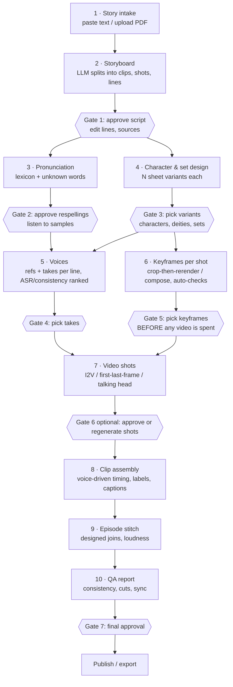
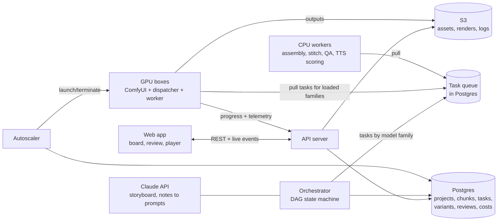
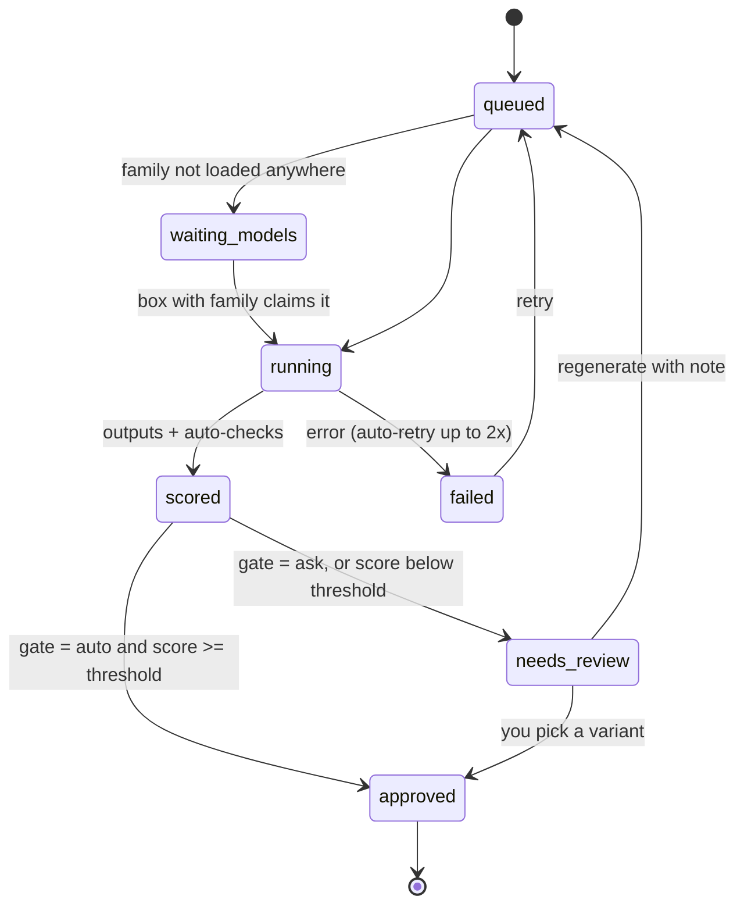

# Orchestration platform: plan

**Goal:** you paste a story or script and watch it move through the pipeline chunk by chunk (episode → clip → shot →
line), always seeing which phase and step each piece is in. The pipeline pauses at defined points for your input:
you review the outputs, pick the variant you like (as you did with Tara image 3, Dadi image 3, room 2), or send it
back with a note. It then continues and delivers the episode with its QA report.

Everything the platform runs already exists as scripts in this repo. The platform adds the state, the queue, the
review screens and the GPU autoscaling around them.

## 1. The flow

Steps 3 and 4 run in parallel once the script is approved. Voices (5) and keyframes (6) also run in parallel. Each
gate unblocks only the work that depends on it, so one clip can be in video while another is still waiting for
keyframe review.

### What each step does today (the code it wraps)

| Step | Unit of work | Existing code | Models (family) | Auto-checks |
|---|---|---|---|---|
| 2 Storyboard | episode | hand-written `storyboard.json` → LLM (Claude) with the storyboard schema | Claude API | schema check, length vs target, sources listed |
| 3 Pronunciation | line | `pipeline/vrea/pronounce` | — (CPU) | unknown-word list, ASR round-trip |
| 4 Design | character / set | Qwen t2i + edit (`ep2_start.py`, `deities2.py`, `tridev_compose.py`) | image, edit | DINOv2 vs prior picks, people gate on plates |
| 5 Voices | line × take | `voice_v2/f5_lines.py`, `voice_score.py`, `vo_chunks.py` | IndicF5, IndicConformer, WavLM | ASR error, speaker similarity, pace, expressiveness |
| 6 Keyframes | shot × variant | `make_clips.py`, `reframe.py`, `s34.py` | edit | identity vs sheet, scene continuity, people gate |
| 7 Video | shot | `comfy.g_i2v`, `s34.g_flf`, `talk.py` | video, talk | jump detector, identity drift (first/mid/last) |
| 8 Assembly | clip | `rebuild34.py`, `assemble.py`, `s34.finish` | — (CPU) | word/label sync, caption timing |
| 9 Stitch | episode | `episode.py` | — (CPU) | join smoothness, dead air, −14 LUFS |
| 10 QA | episode | `ep_consistency.py`, `cuts.py` | OWLv2, DINOv2, WavLM (CPU ok) | the full report |

## 2. What you see

1. **Pipeline board (live).** One column per phase, one card per chunk (clip / shot / line). Each card shows its
   state (`queued` · `waiting for models` · `running 43 %` · `needs your review` · `approved` · `failed`), a
   thumbnail and an ETA. ETAs come from measured per-family run times in `gpu_jobs.jsonl`.
2. **Review queue.** Everything waiting on you, in one list, oldest first, with a badge count.
3. **Variant picker.**
   - A grid of N variants with their auto-scores (identity vs sheet, continuity, ASR error…) and the reference beside
     them, ranked best-first.
   - Actions: **Pick**, **Pick & lock** (becomes a reference for later steps), **Regenerate with note** (your note is
     added to the prompt, e.g. "both seated, Dadi on the left"), or **Edit** (crop or reframe).
   - Audio takes get waveforms and play buttons; video shots get A/B playback.
4. **Clip and episode player.** Plays the latest assembly with a timeline: shots, words, labels, captions and joins.
   You can comment at a timestamp, which creates a fix task on that shot.
5. **Run panel.** GPU boxes (type, region, model families loaded, utilization), live cost against budget, logs.
6. **Settings per gate.** *Always ask*, or *auto-approve when the top score ≥ threshold*. For example, auto-pick voice
   takes with ASR error 0 and speaker similarity ≥ 0.97, but always ask for keyframes.

## 3. Architecture

**Components and choices** (the recommendation first, the alternative after):

- **Orchestrator:** a Python service that turns the storyboard into a DAG of tasks (per clip, shot, line and variant)
  and advances it as tasks finish and gates are approved. State lives in Postgres, so it survives restarts.
  Alternative: Temporal, which is worth it only once many episodes run concurrently.
- **Task queue:** Postgres rows claimed with `SELECT … FOR UPDATE SKIP LOCKED`. One fewer service, transactional with
  the state. Each task carries its **model family**, so GPU workers claim only what their box has loaded. This is the
  `gpu_dispatch.py` rule lifted to the fleet. Alternative: SQS with one queue per family.
- **GPU worker:** runs on each GPU box next to ComfyUI and the dispatcher. It claims tasks, runs the existing scripts,
  uploads outputs to S3, and streams progress (step, %, preview frames) to the API.
- **Autoscaler:**
  - It looks at waiting tasks per family, the budget left and the quotas.
  - It launches a box with `MODELS=fam:<families needed>`, across a region/AZ/type fallback list.
  - It keeps a box warm while a review that unblocks its family is open, and terminates idle boxes.
  - It enforces the budget cap before every launch.
- **CPU workers:** assembly, stitch, QA and pronunciation run on cheap CPU machines (or on the API host), never on the
  GPU box.
- **Web app:** React (Next.js) with live events over server-sent events. Asset previews come from S3 presigned URLs.
- **Auth:** single owner first (you). Add teammates with roles later: reviewer vs operator.

### Data model (core tables)

`project` → `episode` → `clip` → `shot` / `line`

| Table | What it holds |
|---|---|
| `asset` | a generated file: kind, S3 key, step, the inputs/seed/prompt that made it, auto-scores |
| `variant_set` | the N assets competing for one slot, plus the chosen asset id |
| `task` | step, chunk id, model family, state, attempts, timings, cost; dependencies are an edge table |
| `gate` | gate type, chunk, state, policy (ask / auto with threshold) |
| `review` | who, when, decision, note → regenerate tasks |
| `run` | GPU box: instance, type, region, families, start/stop, cost |
| `reference` | locked sheets, voices, plates, lexicon version: what later steps must match |

## 4. How a story moves (state machine per chunk)

## 5. Using the machines well (built into the design)

- Tasks are grouped by **model family**. A box loads only the families it is given and drains them before switching
  (implemented on one box as `gpu_dispatch.py`).
- **Phases match families:** all keyframes for an episode, then review, then all videos. Variants are rendered in one
  batched pass.
- **Draft vs final:** shots are reviewed at draft quality; upscale and interpolation run only on approved shots.
- **Fan-out:** with a higher quota the autoscaler runs one box per family or per scene in parallel. Total cost stays
  roughly the same; wall-clock time divides by the number of boxes.
- **Telemetry** (`gpu.csv`, `gpu_jobs.jsonl`) feeds the run panel and the ETAs.

Details and measurements: [`gpu-utilization.md`](gpu-utilization.md).

## 6. Build plan (milestones)

| Milestone | Delivers | Built from |
|---|---|---|
| **M1 Backbone** | Postgres schema; orchestrator turns `storyboard.json` into tasks; GPU worker wraps today's scripts; CLI to start a story and approve gates. Runs Episode 2 end to end, headless. | `comfy.py`, `gpu_dispatch.py`, scene scripts |
| **M2 Live board + review** | Web app: pipeline board, review queue, variant picker with scores, audio/video players, regenerate-with-note | M1 API |
| **M3 Story intake** | Paste or upload a story; Claude drafts the storyboard (clips, shots, lines, sources) for Gate 1; pronunciation and lexicon review screen | storyboard schema, `pronounce` |
| **M4 Autoscaling and budget** | Family-aware launches, warm-keep during reviews, multi-region fallback, budget cap and cost panel | `launch_gpu.sh`, `models.json`, telemetry |
| **M5 Polish and QA** | Timeline player with comments → fix tasks; QA report page; music bed; upscale/RIFE on approved shots; export | `episode.py`, `ep_consistency.py` |

M1 is the foundation and should come first. Ep2 "Pehla Jeevan" (already drafted, with voices and sheets done) is the
natural first story to run through it.

## 7. Decisions for you

1. **Where it runs:**
   - Option A: a small always-on server (e.g. a t4g.small, about $12/month, plus RDS or Postgres on the same box).
   - Option B: run the web app locally and only the GPU boxes in AWS.
2. **Who uses it:** just you, or reviewers too (needs logins and roles).
3. **Default gate policy:** which gates always ask, and which may auto-approve above a score.
4. **Budget per episode:** the platform enforces it before every GPU launch.
