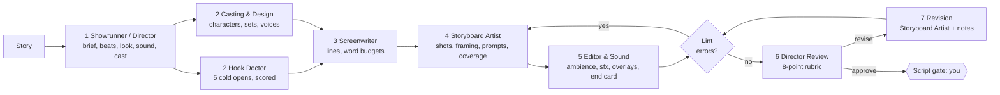

# Writers' room: multi-agent pre-production

Status: built 2026-11-15. Code in `platform/server/writers_room/`, offline test in `platform/tests/test_writers_room.py`.

**What changed:** the storyboard used to come from one Claude call. Now seven specialist agents draft it, a
deterministic linter checks it, and a director agent reviews it. The output is the same storyboard schema as before,
so keyframes, voices, video, assembly and QA are unchanged. You still approve it at the Script gate before any GPU
money is spent. That page now also shows the brief, all five hook candidates with their scores, the beat sheet, the
director's scores and notes, the lint warnings and what the Claude calls cost.

## 1. What the high-retention AI story pages do (reverse-engineered)

Sources: practitioner write-ups on AI Reels, Shorts and micro-drama, plus two multi-agent film papers (listed at the
end). The research found no public second-by-second retention data for specific pages. The patterns below are where
the guides and the papers agree, checked against what the best AI story pages (mythology, horror, micro-drama,
"what happened next" history) visibly do.

| # | Pattern | What the top pages do | How the room encodes it |
|---|---|---|---|
| 1 | **The first 1.5–3 s decide everything** | Cold open on the most arresting moment. Never a title card or a slow establishing wide. | The Hook Doctor writes 5 cold opens and the best scorer becomes shot 01-A. The linter warns if the first shot runs past 3.5 s. |
| 2 | **Three-layer hook** | Visual, a 6–12 word spoken line and 2–6 words of on-screen text all land in second 0–2, built for muted viewers. | Each hook candidate has a `first_frame`, `spoken_line`, `on_screen_text` and `sound_hit`. The Editor puts the text in as a `title` overlay at 0.2 s. |
| 3 | **Hook archetypes** | In-media-res danger, a forbidden rule, an impossible image, a shocking fact, a direct question, "nobody tells you…", a flash-forward. | The 5 candidates must use different archetypes. Each is scored on scroll-stop, curiosity gap, clarity, payoff and feasibility. |
| 4 | **Promise early, pay late, keep opening loops** | By about 8 s the viewer knows what is at stake. New questions open before old ones close. | The Showrunner's beats carry `new_question_opened`. The reviewer has `promise` and `retention` rubric lines. |
| 5 | **Cut cadence** | A new image every 1.5–3 s, a different shot size each cut, a pattern interrupt every 8–12 s. | Storyboard Artist craft rules. The linter checks the average shot length and repeated framing on the same subject. |
| 6 | **Series endings** | Each episode ends on a micro-cliffhanger, or standalone pieces loop back to the first frame. | The brief picks `ending` (cliffhanger, loop or payoff). It is a form option, and the reviewer has an `ending` score. |
| 7 | **Sound is half the hook** | A hit on the first cut, an ambience bed, a drone under tension, silence before reveals, intimate narration. | The Editor & Sound pass uses only sounds the platform can synthesise. The linter warns when the hook has no sound hit. |
| 8 | **Locked identity** | Image-to-video from a locked reference per character, the same outfit every shot, recurring locations and motifs. | Casting writes production-spec descriptions with one fixed outfit and silhouette-distinct characters. The existing ref-sheet gates lock them. |
| 9 | **Write for what the models do well** | Slow camera moves, atmosphere (rain, fog, light), single actions, reveals by light. They avoid fights, hand work, crowds, text in the image and creature morphs. | Playbook rule 9 plus the Showrunner's `risks` list. The linter flags hard actions and quoted text in prompts. |
| 10 | **Emotion over information** | Every clip makes the viewer feel one thing. Concrete sensory lines, with explanation cut. | `emotional_core` in the brief, Screenwriter craft rules and the reviewer's `emotion` score. |

The process behind these pages matches FilmAgent and MovieAgent: a director that critiques a screenwriter's draft in a
loop, then separate storyboard and location (set) roles, with a shared character bank for consistency. The micro-drama
studios add a showrunner that holds the "show bible" for the whole series.

## 2. The agents

| Agent | Input | Output | Effort |
|---|---|---|---|
| Showrunner / Director | story, your directions | logline, emotional core, central question, timed beats, clip plan, visual grammar, sound concept, cast, model risks | high |
| Hook Doctor | brief | 5 scored cold opens and a winner (frame, line, text, sound hit) | high |
| Casting & Production Design | cast, locations, look | `characters`, `sets`, `voices` (Parler descriptions for English) | medium |
| Screenwriter | brief, hook, speakers | every line (tts, caption, emotion, fx), with clip 01 opening on the hook line | high |
| Storyboard Artist / Cinematographer | all of the above | shots: tech, timing, framing, refs, prompts, `cover`, `vo` | high |
| Editor & Sound Designer | shots and lines | a patch with ambience, music, sfx, overlays and end card (invalid values are dropped) | medium |
| Director Review | storyboard and lint report | scores out of 10 for hook, promise, retention, pacing, clarity, ending, feasibility and emotion, plus notes for each role; approve or revise | high |

**How it runs:**
- Every agent shares one system prefix: the playbook, the platform rules, the language rules and the story. Calls after
  the first read that prefix from the prompt cache.
- Hook Doctor and Casting run in parallel.
- Hard lint errors (things the platform would reject) go back to the Storyboard Artist up to twice. If any remain, the
  draft fails with the reason instead of reaching you broken.
- There is one revision round by default (`max_revisions`).
- A whole run is about 9–11 calls, takes 5–10 minutes and costs roughly $1–3 on Opus 5.5. It runs in a background
  thread, and each agent's progress shows in the board's event log.
- The old single-call drafter is still there as "Quick" on the New story page.

**Where to tune it:**
- The research rules live in one place, `writers_room/playbook.py` (`PLAYBOOK`). Change them there and every agent
  follows.
- Role craft and output contracts are in `roles.py`.
- Pacing thresholds are in `lint.py`.

## 3. Improving the rest of the pipeline (ranked by expected impact on retention)

These are outside pre-production and not built yet.

1. **Hook frame A/B.** Render 4 keyframe variants for shot 01-A instead of 2, and rank them with a Claude vision
   "scroll-stop" judge (the drift judge already sends frames to Claude). This spends GPU time where it matters most.
2. **Final-cut retention review.** After `episode` assembly, send frames every 0.5 s plus the transcript to a Claude
   reviewer that marks dead stretches, unclear moments when muted, and a weak last frame. Put its notes on the
   final-approval gate as fix tasks.
3. **Kinetic captions.** Highlight the word currently being spoken and give key words a slight size bump. The current
   captions are static 2-line chunks, and the guides single out word-timed text as a retention lever.
4. **A real music bed and sfx library.** The synthesized drone and sfx are stand-ins. A small licensed library tagged
   by mood, with beat-synced cut points, would lift the sound layer most.
5. **Loop endings.** For `ending: loop`, render the last shot as FLF from its keyframe to the 01-A keyframe, so the
   Reel loops seamlessly.
6. **Identity LoRA** per main character (already open item A in `episode1-findings.md`). Series pages live or die on
   recognisable characters.
7. **Series bible across episodes.** Persist the brief's `visual`, cast designs, voice descriptions and the
   cliffhanger, then feed them to the next episode's Showrunner (the micro-drama "showrunner holds the bible" pattern).
8. **Learn from your own numbers.** Once episodes are posted, log 3 s hold rate, average watch % and rewatches per
   hook archetype. Feed the winners back into the Hook Doctor's prompt.

## Sources

- FilmAgent: multi-agent film automation (director, screenwriter, actor, cinematographer; critique loop):
  [arXiv 2501.12909](https://arxiv.org/html/2501.12909v1), [project page](https://filmagent.github.io/)
- MovieAgent: automated movie generation via multi-agent CoT planning (director, screenwriter, storyboard artist,
  location manager): [arXiv 2503.07314](https://arxiv.org/abs/2503.07314)
- Hook timing, open loops and pattern interrupts:
  - [postiz: hook framework](https://postiz.com/blog/why-your-reels-arent-going-viral-hook-framework)
  - [virlo: the science behind "what happens next?"](https://virlo.ai/blog/the-science-behind-what-happens-next)
  - [socialk.it: Reels retention strategy](https://socialk.it/en/blog/instagram-reels-retention-strategy)
  - [motionbox: AI Reels in 2026](https://motionbox.io/blog/how-to-make-ai-instagram-reels-that-go-viral-in-2026)
  - [reelmind: viral Reels deconstructed](https://reelmind.ai/blog/viral-content-deconstructed-analyzing-top-ig-reels-and-how-to-beat-them-with-ai)
- Faceless and AI Reels workflows:
  - [invideo: faceless Reels creator stack](https://invideo.io/blog/faceless-reels-ai-creator-stack/)
  - [flowshorts: how to make faceless Reels](https://flowshorts.app/blog/how-to-make-faceless-reels)
  - [postlabs: faceless formats that scale](https://postlabs.ai/blog/instagram-reels/faceless-instagram-reels-formats-that-scale)
- Micro-drama production (showrunner bible, locked references, episode beats, cliffhangers):
  - [invideo: AI micro-drama](https://invideo.io/blog/how-to-make-ai-micro-drama/)
  - [minionarts: AI microdrama playbook](https://www.minionarts.com/blogs/how-to-make-ai-microdrama-2026-production-playbook)
  - [outlierkit: AI tools for vertical micro-drama](https://outlierkit.com/resources/ai-tools-vertical-micro-drama-2026/)
  - [dev.to: AI drama series for Reels](https://dev.to/cartney/why-ai-drama-series-for-reels-crush-single-videos-1pcf)
- AI horror shorts (hook frame, whisper narration over a synth pad, loopable last frame):
  - [dev.to/genra: AI short dramas retention guide](https://dev.to/genra_ai/how-to-create-ai-short-dramas-solo-with-genra-production-retention-guide-1m0e)
  - [aivideosensei: the 3-second hook system](https://aivideosensei.com/guides/youtube-shorts-with-ai)
  - [frameo: AI horror short films](https://frameo.ai/blog/creating-ai-horror-short-films/)
- Mythology pages:
  - [xstonedape profile](https://www.thedaringcreatives.com/creator-stories/xstonedape-ai-mythology-creature-art/)
  - [Business Standard: AI and India's ancient knowledge](https://www.business-standard.com/opinion/columns/ai-brings-alive-india-s-ancient-knowledge-through-modern-technology-126110800357_1.html)
  - [Medium: AI mythology Reels](https://medium.com/technology-hits/ai-mythology-reels-in-2026-5e679c77a0b7)

Most practitioner sources are vendor blogs. Treat their numbers as rules of thumb, and confirm them against your own
analytics (step 8 above).
